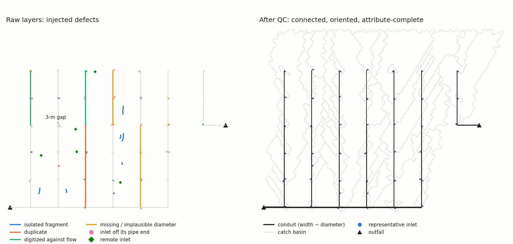

# stormwater-network-qc

Python tools that turn municipal stormwater infrastructure GIS layers (pipes,
inlets, outfalls) into a connected, attribute-complete drainage network ready
to build a model in the Storm Water Management Model (SWMM).

## What problem it solves

Pipe and inlet layers are maintained for asset management, not for hydraulic
modelling. Before they can be used in SWMM they typically need fixing:

* pipes that should meet miss each other by millimetres to centimetres, and
  laterals join trunks in the middle of a segment;
* fragments of abandoned or local systems drain to no outfall, and parts of
  the system are cut off from it by digitizing gaps;
* pipes are digitized twice or against the flow;
* diameters are missing, or another attribute (e.g. depth) was typed in the
  diameter field;
* there are no invert elevations, so pipe slopes are unknown;
* inlets sit metres from the pipe they feed, are attached to removed pipes,
  or are grouped at street corners where each would get a tiny catch basin.

Each function in the package detects and corrects one of these problems, and
`run_workflow` chains them, reporting every change and every decision that
needs a human check. It is intended for engineers and researchers building
SWMM models of urban drainage from municipal GIS data.

Because municipal infrastructure data usually cannot be shared, the package
includes a **synthetic network generator** that reproduces all these defect
types and records the ground truth; it is used to demonstrate and test every
correction.



## Installation

```bash
pip install -e ".[watersheds]"            # package + catch-basin delineation (pysheds)
pip install -e ".[watersheds,examples,test]"  # + example figures, notebook and tests
```

The package is imported as `stormwater_qc`. Without `pysheds`, everything
except catch-basin delineation works: pass `delineate=False` to
`run_workflow` (or `--no-basins` to the example script).

## Quick start (synthetic network)

```bash
python examples/synthetic_workflow.py --figure synthetic_workflow.png
```

builds the synthetic network, runs every step, and prints how each injected
defect was corrected compared with the ground truth:

| defect | injected | corrected | matches truth |
|---|---|---|---|
| near-miss ends (0.1 mm-8 cm gaps, mid-segment junctions) | 38 | 38 | yes |
| isolated fragments (no outfall) | 16 pipes | 16 | yes |
| network cut off by a 3-m gap | 1 | 1 | yes |
| duplicate pipes | 4 | 4 | yes |
| pipes digitized against the flow | 15 | 15 | yes |
| depth typed as diameter | 2 | 2 | yes |
| missing diameters | 8 | 8 | yes (6 of 8 equal to the true value) |
| inlets off the end of their pipe (about 1-6 m) | 23 | 23 snapped to the right junction | yes |
| remote or orphaned inlets | 11 | 11 | yes |
| whole-pipe DEM slope outside 1.5-4.6 m/s | 71 segments | 71 within limits | yes |

[`examples/step_by_step.ipynb`](examples/step_by_step.ipynb) applies the
functions one at a time to the synthetic network and draws the result of
each step (zooming on the defects, which are often centimetres wide), with
the match against the ground truth printed under every figure.

## Using it on your own data

### Input data

All layers in one **projected CRS in metres** (e.g. a UTM zone):

| Layer | Geometry | Required | Optional |
|---|---|---|---|
| pipes | LineString or MultiLineString | `diameter` in metres (0 or NaN = missing) | `pipe_id` (kept as `parent_id` in the outputs); a depth column, passed as `depth_field="..."`, to flag depths typed as diameters |
| inlets | Point | - | `inlet_id` (used in the log) |
| outfalls | Point within `outfall_tolerance` (default 1 m) of a pipe end | - | - |
| DEM(s) | GeoTIFF of ground elevation (m), same CRS | a fine DEM (e.g. 1 m) | a coarse DEM (e.g. 5 m), used as a second slope estimate and for catch-basin delineation |

`run_workflow` stops with an error if the CRS is geographic, if the layers
or the DEM are in different CRSs, or if `diameter` is missing, and warns if
diameters look like inches or millimetres. An outfall that matches no pipe
end is reported with a warning: its network cannot be oriented and may be
removed as isolated.

### Running

```python
import geopandas as gpd
from stormwater_qc.workflow import run_workflow

pipes = gpd.read_file("pipes.gpkg")
inlets = gpd.read_file("inlets.gpkg")
outfalls = gpd.read_file("outfalls.gpkg")

result = run_workflow(pipes, inlets, outfalls, "dem_1m.tif", "dem_5m.tif")
print(result.log["networks"])             # every network, its size, outfall and category
print(result.log["networks_to_inspect"])  # mid-size networks without an outfall: check in GIS
```

Then inspect the flagged items in GIS and run again with your decisions,
e.g. `run_workflow(..., keep_networks=[12, 40])`. Every argument (tolerances,
velocity limits, connector diameter, cover...) is documented in
`help(run_workflow)`, and each step can also be called on its own (see
**Steps**).

### Outputs

| Output | Content |
|---|---|
| `result.segments` | Conduits (2-vertex lines oriented in the flow direction): `segment_id`, `parent_id` (your `pipe_id`), `us_node`, `ds_node`, `diameter` (m), `diameter_source`, `slope` (m/m), `velocity` (full-flow, m/s), `slope_source`, `offset_in`, `offset_out` (m) |
| `result.junctions` | Junctions: `node_id`, `depth` (m), `rim_elev`, `invert_elev` (m) |
| `result.inlets` | Inlets: `node_id` (junction), `snap_distance` (m), `needs_review`, `cluster_id`, `representative`, `role` |
| `result.basins` | One catch basin per inlet cluster (`gridcode` = `cluster_id`) |
| `result.log` | What every step changed and what needs review |
| `result.steps` | Intermediate products (raw segments, all junctions, cluster points...) |

In `result.log`, keys ending in `_pipes` list your `pipe_id` values, keys
ending in `_segments` list `segment_id` values of
`result.steps["segments_raw"]`, and inlet lists hold `inlet_id` values (or
the index labels of the input inlets).

**Into SWMM.** The package does not write a SWMM `.inp` file. Save the layers
(e.g. `result.segments.to_file("model.gpkg", layer="conduits")`, likewise
junctions, inlets and basins) and import them with a GIS-based SWMM tool
(e.g. the GIS import of PCSWMM), mapping `us_node`/`ds_node` to the conduit inlet/outlet
nodes, `offset_in`/`offset_out` to the conduit offsets, and `invert_elev`,
`depth` to the junctions. Catch basins carry only their geometry and outlet
cluster: sub-catchment parameters (area, width, imperviousness, infiltration)
must be added.

## Steps

| Module | Function | Problem it solves |
|---|---|---|
| `geometry` | `clean_geometry` (`snap_endpoints` + `split_at_vertices`); `extend_lines` (standalone alternative to snapping) | pipe ends that nearly meet; pipes meeting mid-segment; polylines spanning several junctions |
| `networks` | `reconnect_networks` | parts of the system separated by a digitizing gap |
| | `classify_networks`, `remove_isolated_networks` | fragments that drain to no outfall (with a list of mid-size networks to inspect) |
| | `remove_duplicates` | pipes digitized twice, in either direction |
| `topology` | `build_nodes` | junctions and the end nodes of each conduit |
| | `orient_to_outfalls` | pipes digitized against the flow: each pipe points toward the outfall it reaches |
| | `connectivity` | upstream and downstream pipes of each pipe |
| `inlets` | `select_inlets`, `snap_inlets` | inlets on removed pipes or far from any pipe; inlets off their junction |
| | `cluster_inlets`, `cluster_points` | groups of inlets that would give tiny catch basins (DBSCAN, 25 m) |
| | `representative_inlets`, `merge_connectors` | one inlet per basin; removed connector pipes' capacity added to the kept one |
| `diameters` | `flag_diameter_outliers` | diameters far larger than every neighbour, or equal to the depth |
| | `reconstruct_diameters` | missing diameters, from upstream/downstream pipes (Shrestha et al., 2022) |
| `slopes` | `estimate_slopes` | no inverts: DEM slopes, corrected to full-flow velocities within design limits |
| `watersheds` | `delineate` | one catch basin per inlet cluster (D8 flow, priority-flood for flats; Barnes et al., 2014) |
| `swmm` | `node_depths`, `node_inverts`, `conduit_offsets` | junction depths and inverts; offsets that make SWMM reproduce each slope |
| `synthetic` | `make_synthetic_network`, `evaluate` | test network with known defects; scoring against the truth |

Several steps reproduce operations usually done interactively in GIS or in
PCSWMM (e.g. Extend Line, Auto-Connect, Minimum Bounding Geometry, Watershed);
the docstrings name the equivalent tool.

## Design choices and limits

* **Defaults reflect one application; set your own.** The velocity limits
  (1.5-4.6 m/s) follow the Drainage Design Manual for Maricopa County,
  Arizona; the connector-pipe diameter (0.381 m, 15 in) and the cover above
  pipes (0.914 m, 36 in) are the values used in that application. Set
  `vmin`, `vmax`, `connector_diameter` and `cover` to your local standard. Tolerances (0.1 m snapping, 5 m maximum gap, 1 m
  outfall and inlet distances, 25 m inlet clusters, 30 m pour-point
  snapping) suit an arterial-scale urban model and are all arguments.
* **Judgement is reported, not hidden.** Mid-size networks without an outfall
  (`log["networks_to_inspect"]`), inlets moved more than 2 m
  (`log["inlets_to_review"]`) and diameters no rule can fill
  (`diameter_source == "unresolved"`) are listed for checking in GIS.
* **Missing trunk diameters are underestimated.** When no diameter is shared
  upstream and downstream, the largest upstream diameter is assigned; for a
  trunk that widens downstream this is a lower bound (in the synthetic
  network, 0.381 m for a 0.610-m trunk fed only by 15-in connectors).
* **Slopes are hydraulic estimates, not survey data.** They respect the
  velocity limits by construction and should be replaced by surveyed inverts
  where these exist.
* The synthetic network is placed in an arbitrary projected CRS (UTM Zone
  12N); its location has no meaning.

## Testing

```bash
pytest
```

runs the full workflow on five random synthetic networks and checks that
every injected defect is corrected as in the ground truth, that the final
network drains to its outfalls, and that SWMM will reproduce every slope.

## Related publication

The methods were developed to build the stormwater model described in:
Srivastava, N. A., Sparks, R., Chester, M., Porto, M., Johnson, N., and
Mascaro, G. (2026). A coupled stormwater-power model for the simulation of
cascading infrastructure failures: An application in Phoenix, AZ.
*Environmental Modelling & Software*, 201, 106980.
https://doi.org/10.1016/j.envsoft.2026.106980

## References

Barnes, R., Lehman, C., and Mulla, D. (2014). Priority-flood: An optimal
depression-filling and watershed-labeling algorithm for digital elevation
models. *Computers & Geosciences*, 62, 117-127.
https://doi.org/10.1016/j.cageo.2013.04.024

Shrestha, A., Mascaro, G., and Garcia, M. (2022). Effects of stormwater
infrastructure data completeness and model resolution on urban flood
modeling. *Journal of Hydrology*, 607, 127498.
https://doi.org/10.1016/j.jhydrol.2022.127498

## Citation

See [CITATION.cff](CITATION.cff).

## Acknowledgements

This work has been supported by the National Institute of Standards and
Technology (NIST)-National Science Foundation (NSF) award #70NANB22H056,
"DRRG: Assessing the Utility of Safe-To-Fail Design to Improve Climate
Hazards Resilience of Interdependent Infrastructure Systems."

## License

MIT; see [LICENSE](LICENSE).
